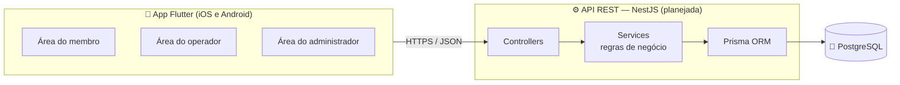

<div align="center">


**Carteirinha digital white-label para programas de associados**


Trabalho final de **HADS022 – Laboratório de Desenvolvimento de Sistemas**<br>
Análise e Desenvolvimento de Sistemas · Universidade de Passo Fundo · 2026/2

</div>

---

## 💡 Sobre o projeto

Clubes, academias, associações e sindicatos costumam controlar seus associados com carteirinhas de papel
e planilhas. O **MembroPass** substitui esse processo por uma plataforma em que:

- a **organização** configura planos, benefícios, unidades e a própria marca da carteirinha;
- o **membro** apresenta uma carteirinha digital com QR Code no celular;
- o **operador** valida o acesso nas unidades e eventos lendo o QR Code.

O pagamento da mensalidade é combinado fora do aplicativo. O administrador confirma o recebimento
para liberar um novo ciclo e decide manualmente quando bloquear um membro vencido. O sistema nunca
bloqueia nem libera de forma automática.

> **Recomeço do desenvolvimento (28/10/2026):** a implementação foi reiniciada do zero, uma etapa por vez.
> O código das semanas 1 a 3 continua disponível no histórico do Git (tags `semana-1` a `semana-3`).

## ✅ O que já funciona

| Etapa | Requisitos | Situação |
|---|---|---|
| Tela de boas-vindas, login e encaminhamento por papel | RF01, RF02 | ✅ No app, com autenticação simulada |
| API de autenticação | RF01, RF02 | ⬜ A fazer |

Detalhes do app: [`app/README.md`](app/README.md).

## 🏗️ Arquitetura

Arquitetura em camadas, com isolamento de dados por organização (multi-tenant), conforme o DVP v2.6.



## 📁 Estrutura do repositório

```
HADS_JuliaVeiga_MembroPass/
├── app/      # Aplicativo Flutter (membro, operador e administrador)
└── api/      # API REST em NestJS (próximas etapas)
```

## 🚀 Como executar o app

**Pré-requisitos:** [Flutter 3.41+](https://docs.flutter.dev/get-started/install), Android Studio com um emulador
e JDK 17.

```bash
cd app
flutter pub get
flutter run
```

Enquanto a API não existe, o login usa contas de teste (senha `Senha@123` para todas):

| Papel | E-mail |
|---|---|
| Administrador da organização | `admin@membropass.dev` |
| Operador | `operador@membropass.dev` |
| Membro | `membro@membropass.dev` |

Testes automatizados:

```bash
cd app
flutter test
```

## 👩‍💻 Autora

**Julia Camini Veiga**<br>
Orientação: Prof. Jaqson Dalbosco e Prof. Jeangrei Emanoelli Veiga
