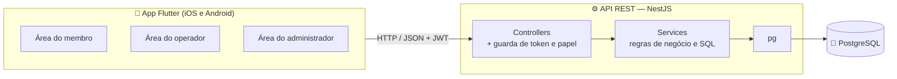

<div align="center">


**Carteirinha digital white-label para programas de associados**


Trabalho final de **HADS022 – Laboratório de Desenvolvimento de Sistemas**<br>
Análise e Desenvolvimento de Sistemas · Universidade de Passo Fundo · 2026/2

</div>

---

## 💡 Sobre o projeto

Clubes, academias, associações e sindicatos costumam controlar seus associados com carteirinhas de papel
e planilhas. O **MembroPass** substitui esse processo por uma plataforma em que:

- a **organização** configura planos, benefícios, unidades e a própria marca da carteirinha;
- o **membro** apresenta uma carteirinha digital com QR Code no celular;
- o **operador** valida o acesso nas unidades e eventos lendo o QR Code.

O pagamento da mensalidade é combinado fora do aplicativo. O administrador confirma o recebimento
para liberar um novo ciclo e decide manualmente quando bloquear um membro vencido. O sistema nunca
bloqueia nem libera de forma automática.

> **Recomeço do desenvolvimento (28/10/2026):** a implementação foi reiniciada do zero, uma etapa por vez.
> O código das semanas 1 a 3 continua disponível no histórico do Git (tags `semana-1` a `semana-3`).

## ✅ O que já funciona

| Etapa | Requisitos | Situação |
|---|---|---|
| Boas-vindas, login e encaminhamento por papel | RF01, RF02 | ✅ App e API, com bloqueio após 5 tentativas |
| Painel do administrador | RF02, RF18 | ✅ Atalhos para todas as seções e contato do suporte |
| Planos de associação | RF04 | ✅ Listar, criar, editar, desativar e reativar |
| Membros e carteirinha | RF05, RF06 | ✅ Cadastro com senha provisória; carteirinha emitida por trigger |
| Liberação de ciclo, bloqueio e auditoria | RF07, RF16 | ✅ Pagamento confirmado manualmente; auditoria imutável |
| Benefícios | RF08 | ✅ Com vigência e planos com direito |
| Unidades e eventos | RF11 | ✅ Com período (eventos) e planos aceitos |
| Operadores | RF02 | ✅ Cadastro pelo administrador com senha provisória, nova senha, desativação e atividade do dia; perfil do operador (foto, celular e troca de senha) |
| Identidade visual | RF17 | ✅ Logo, cor com verificação de contraste e prévia |
| Área do membro (carteirinha com QR e benefícios) | RF05, RF09 | ✅ Cadastro obrigatório no primeiro acesso (dados, endereço, foto e declaração de veracidade); carteirinha vertical com foto e QR dinâmico (muda a cada 30 s); benefícios e locais do plano |
| Segurança e e-mail | RF01, HU03 | ✅ Sessão encerrada ao desativar ou trocar senha, troca obrigatória da senha provisória, recuperação por código no e-mail (Gmail/SMTP), limite por IP, helmet e auditoria das ações sobre operadores |
| Check-in pelo operador | RF10 | ✅ Escolha do local (unidades e eventos do dia), leitura do QR pela câmera, foto do membro para conferência, recusa com motivo (bloqueada, desativada, QR antigo, plano não aceito) e alerta de vencida; leituras do dia gravadas por local |

## 🏗️ Arquitetura

Arquitetura em camadas, com isolamento de dados por organização (multi-tenant), conforme o DVP v2.6.
A API acessa o banco com **SQL puro** (biblioteca `pg`), sem ORM, e toda consulta filtra pela
organização do usuário logado.



## 📁 Estrutura do repositório

```
HADS_JuliaVeiga_MembroPass/
├── app/            # Aplicativo Flutter (membro, operador e administrador)
└── api/            # API REST em NestJS
    └── database/   # Scripts SQL: tabelas, regras de negócio (triggers e funções) e dados de teste
```

## 🚀 Como executar

**Pré-requisitos:** [Flutter 3.41+](https://docs.flutter.dev/get-started/install), Android Studio com um emulador,
JDK 17, [Node.js 22+](https://nodejs.org) e [PostgreSQL 18](https://www.postgresql.org/download/).

### 1. Banco de dados (só na primeira vez)

No pgAdmin (Query Tool no banco `postgres`), rode um comando de cada vez:

```sql
CREATE ROLE membropass LOGIN PASSWORD 'membropass' CREATEDB;
CREATE DATABASE membropass OWNER membropass;
```

### 2. API

```bash
cd api
npm install
cp .env.example .env      # só na primeira vez
npm run db:recriar        # cria as tabelas e os dados de teste (apaga o que existir!)
npm run start:dev         # API em http://localhost:3000
```

### 3. App

Com a API rodando e o emulador aberto:

```bash
cd app
flutter pub get
flutter run
```

O app procura a API em `http://10.0.2.2:3000`, que é o computador visto de dentro do emulador Android.
Para outro endereço: `flutter run --dart-define=API_URL=http://<endereço>:3000`.

### Contas de teste

Senha `Senha@123` para todas (organização **Clube Exemplo**):

| Papel | E-mail |
|---|---|
| Administrador da organização | `admin@membropass.dev` |
| Operador | `operador@membropass.dev` |
| Membro | `membro@membropass.dev` |

Os dados de teste também trazem membros em situações diferentes (em dia, vencendo em breve e vencido),
três planos, dois benefícios, uma unidade e um evento.

### E-mail (recuperação de senha e senha provisória)

Sem configuração, a API não envia nada: os e-mails aparecem no terminal da API (bom para testar).
Para enviar de verdade pelo Gmail, preencha no `api/.env`:

1. Ative a verificação em duas etapas na conta Google.
2. Crie uma **senha de app** em <https://myaccount.google.com/apppasswords>.
3. Preencha `SMTP_HOST=smtp.gmail.com`, `SMTP_PORTA=465`, `SMTP_USUARIO=seu-email@gmail.com`,
   `SMTP_SENHA=<senha de app, 16 letras>` e, se quiser, `EMAIL_REMETENTE="MembroPass <seu-email@gmail.com>"`.
4. Reinicie a API.

### Publicar online (Render + Neon, gratuito)

A API roda no [Render](https://render.com) e o banco no [Neon](https://neon.tech), ambos no plano gratuito.
No Render gratuito a API "dorme" após 15 minutos sem uso; o primeiro acesso depois disso leva perto de
1 minuto (o app espera e já acorda a API ao abrir). O Render gratuito também bloqueia SMTP, por isso os
e-mails saem por um Google Apps Script na conta do Gmail.

1. **Banco:** crie um projeto no Neon e copie a *connection string*. Dentro de `api/`, rode
   `node scripts/preparar-producao.mjs "<connection string>" --organizacao "Nome" --cnpj 00000000000000 --admin "Seu Nome" --email voce@exemplo.com`.
   O script cria as tabelas (sem dados de teste) e mostra a senha provisória do primeiro administrador.
2. **E-mail:** logado no Gmail que vai enviar, crie um projeto em <https://script.google.com>, cole
   `api/scripts/envio-email.gs` e preencha `SEGREDO` (o mesmo de `EMAIL_APPS_SCRIPT_SEGREDO`). Rode a função
   `testar` para autorizar o Gmail; depois *Implantar > Nova implantação > App da Web* (executar como "Eu",
   acesso "Qualquer pessoa") e copie a URL terminada em `/exec`.
3. **API:** no Render, *New > Blueprint* com este repositório (usa o `render.yaml`). Preencha `DATABASE_URL`,
   `EMAIL_APPS_SCRIPT_URL` e `EMAIL_APPS_SCRIPT_SEGREDO`. O `JWT_SECRET` é gerado pelo Render.
4. **App:** gere o instalador apontando para a API online:
   `flutter build apk --release --dart-define=API_URL=https://<sua-api>.onrender.com`
   (o APK fica em `app/build/app/outputs/flutter-apk/app-release.apk`). No iPhone, é preciso um Mac com Xcode.

### Segurança

- **Sessão:** o token só vale enquanto a conta estiver ativa. Desativar alguém, trocar ou redefinir a senha
  encerra as sessões abertas na hora.
- **Senha provisória:** membros e operadores cadastrados pelo admin recebem uma senha provisória
  (na tela e por e-mail) e precisam criar a própria no primeiro acesso.
- **Recuperação:** código de 6 dígitos por e-mail, válido por 15 minutos, uso único, até 5 tentativas.
- **Limites:** 5 erros de senha bloqueiam o e-mail por 1 minuto; por IP, 10 logins e 5 pedidos de código por minuto.
- **QR Code dinâmico:** o app gera um código novo a cada 30 s (funciona sem internet depois de abrir a
  carteirinha). Foto ou captura de tela expira em cerca de 1 minuto.
- **Segredo:** em produção (`NODE_ENV=production`), a API não sobe com o `JWT_SECRET` de exemplo ou curto.

### Testes automatizados

```bash
cd app && flutter test    # app (usa repositórios simulados, não precisa da API)
cd api && npm test        # API
```

## 👩‍💻 Autora

**Julia Camini Veiga**<br>
Orientação: Prof. Jaqson Dalbosco e Prof. Jeangrei Emanoelli Veiga
