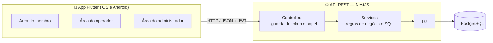

<div align="center">


**Carteirinha digital white-label para programas de associados**


Trabalho final de **HADS022 – Laboratório de Desenvolvimento de Sistemas**<br>
Análise e Desenvolvimento de Sistemas · Universidade de Passo Fundo · 2026/2

</div>

---

## 💡 Sobre o projeto

Clubes, academias, associações e sindicatos costumam controlar seus associados com carteirinhas de papel
e planilhas. O **MembroPass** substitui esse processo por uma plataforma em que:

- a **organização** configura planos, benefícios, unidades e a própria marca da carteirinha;
- o **membro** apresenta uma carteirinha digital com QR Code no celular;
- o **operador** valida o acesso nas unidades e eventos lendo o QR Code.

O pagamento da mensalidade é combinado fora do aplicativo. O administrador confirma o recebimento
para liberar um novo ciclo e decide manualmente quando bloquear um membro vencido. O sistema nunca
bloqueia nem libera de forma automática.

> **Recomeço do desenvolvimento (28/10/2026):** a implementação foi reiniciada do zero, uma etapa por vez.
> O código das semanas 1 a 3 continua disponível no histórico do Git (tags `semana-1` a `semana-3`).

## ✅ O que já funciona

| Etapa | Requisitos | Situação |
|---|---|---|
| Boas-vindas, login e encaminhamento por papel | RF01, RF02 | ✅ App e API, com bloqueio após 5 tentativas |
| Painel do administrador | RF02 | ✅ Atalhos para as seções (as próximas aparecem como "Em breve") |
| Planos de associação | RF04 | ✅ Listar, criar, editar, desativar e reativar |
| Membros e carteirinha | RF05, RF06 | ⬜ A fazer |
| Liberação de ciclo, bloqueio e auditoria | RF07, RF16 | ⬜ A fazer |
| Benefícios | RF08, RF09 | ⬜ A fazer |
| Unidades, eventos e check-in | RF10, RF11 | ⬜ A fazer |
| Identidade visual e suporte | RF17, RF18 | ⬜ A fazer |

## 🏗️ Arquitetura

Arquitetura em camadas, com isolamento de dados por organização (multi-tenant), conforme o DVP v2.6.
A API acessa o banco com **SQL puro** (biblioteca `pg`), sem ORM, e toda consulta filtra pela
organização do usuário logado.



## 📁 Estrutura do repositório

```
HADS_JuliaVeiga_MembroPass/
├── app/            # Aplicativo Flutter (membro, operador e administrador)
└── api/            # API REST em NestJS
    └── database/   # Scripts SQL: criação das tabelas e dados de teste
```

## 🚀 Como executar

**Pré-requisitos:** [Flutter 3.41+](https://docs.flutter.dev/get-started/install), Android Studio com um emulador,
JDK 17, [Node.js 22+](https://nodejs.org) e [PostgreSQL 18](https://www.postgresql.org/download/).

### 1. Banco de dados (só na primeira vez)

No pgAdmin (Query Tool no banco `postgres`), rode um comando de cada vez:

```sql
CREATE ROLE membropass LOGIN PASSWORD 'membropass' CREATEDB;
CREATE DATABASE membropass OWNER membropass;
```

### 2. API

```bash
cd api
npm install
cp .env.example .env      # só na primeira vez
npm run db:recriar        # cria as tabelas e os dados de teste (apaga o que existir!)
npm run start:dev         # API em http://localhost:3000
```

### 3. App

Com a API rodando e o emulador aberto:

```bash
cd app
flutter pub get
flutter run
```

O app procura a API em `http://10.0.2.2:3000`, que é o computador visto de dentro do emulador Android.
Para outro endereço: `flutter run --dart-define=API_URL=http://<endereço>:3000`.

### Contas de teste

Senha `Senha@123` para todas (organização **Clube Exemplo**):

| Papel | E-mail |
|---|---|
| Administrador da organização | `admin@membropass.dev` |
| Operador | `operador@membropass.dev` |
| Membro | `membro@membropass.dev` |

### Testes automatizados

```bash
cd app && flutter test    # app (usa repositórios simulados, não precisa da API)
cd api && npm test        # API
```

## 👩‍💻 Autora

**Julia Camini Veiga**<br>
Orientação: Prof. Jaqson Dalbosco e Prof. Jeangrei Emanoelli Veiga
